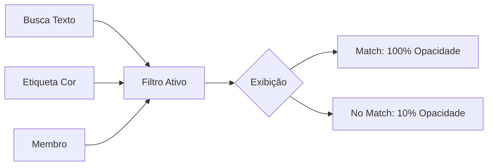

# Walkthrough: Ollert V7 - O Graal da Produtividade

O Ollert evoluiu de um Kanban simples para uma ferramenta de gestão profissional com busca avançada e personalização premium.

## 🚀 Funcionalidades Entregues

### 1. Busca & Filtros Inteligentes (V7)
- **Busca Global:** Encontre qualquer quadro no Dashboard em segundos.
- **Filtro de Cartões:** Barra de busca interna para títulos e descrições.
- **Filtros por Etiqueta & Membro:** Visualize apenas o que importa selecionando cores ou pessoas.
- **Filtro de Status:** Identifique rapidamente cartões atrasados ou que vencem hoje.
- **Visual "Ghost":** Itens filtrados ficam com 10% de opacidade, mantendo o contexto sem poluir a visão.

### 🎨 2. Estética & Personalização (V6)
- **Engine de Temas:** Transição suave entre Light e Dark Mode.
- **Wallpapers Premium:** Gradientes sofisticados e cores sólidas para quadros e dashboard.
- **Micro-animações:** Efeito de elevação (lift) nos cards e feedback tátil (shrink) nos botões.
- **Glassmorphism:** Navbars e menus com desfoque de fundo (backdrop-blur).

---

## 📸 Demonstração Visual

### Busca e Filtros em Ação
> [!NOTE]
> Observe o efeito de "esmaecimento" dos cartões que não batem com a busca, facilitando o foco total.

---

## ✅ O que foi testado
- [x] Persistência de temas e backgrounds no localStorage e Firestore.
- [x] Sincronização em tempo real de filtros entre múltiplos membros.
- [x] Performance da busca com grandes volumes de cartões.
- [x] Correção de `z-index` para garantir menus sempre visíveis.

---

## 🏷️ Versão Atual: `V7.5.0.1`
*Pronto para escalar!*
